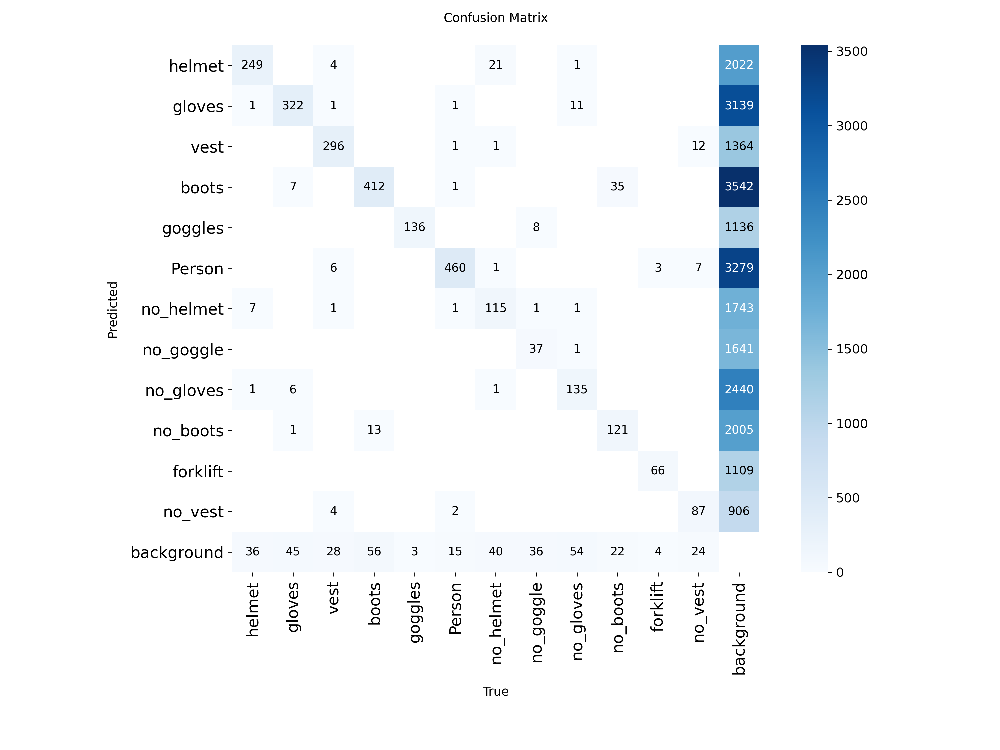

# 건설현장 안전모 미착용 탐지: YOLO26n 프로토타입과 오류 분석

> 모바일 머신러닝응용(2026-2) 텀 프로젝트 제안서의 실험 계획(E1·E2·오류 분석)을 개인이 먼저 구현해 본 프로토타입입니다.
> 제안서는 조원들이 함께 작성했습니다.

**핵심 질문:** 안전모(`helmet`)와 미착용 머리(`no_helmet`)의 탐지 성능은 어떻게 다르고, 모델은 **어떤 조건에서 미착용을 놓치는가?**

---

## 한눈에 보는 결과

| 구분 | 내용 |
|---|---|
| 맨머리 Recall | 약 **0.58**. 실제 맨머리 179개 중 약 75개를 놓침 (신뢰도 0.25, IoU 0.5 기준) |
| 가장 큰 원인 | **이미지 출처(촬영 거리).** 가까이서 찍은 생성 이미지에서는 미탐률 약 5%, 멀리서 찍은 현장 사진에서는 약 **74%** |
| 크기 효과 | 같은 출처 안에서도 머리가 작을수록 미탐률이 높음 |
| 위험한 오류 | 맨머리를 **안전모 착용으로 착각**한 경우가 21건 (혼동 행렬 기준) |
| 오탐의 실체 | 오탐 13건 중 최소 5건은 모델이 맨머리를 맞게 찾았지만 **채점 기준(박스 범위 차이·중복 예측)** 때문에 오탐으로 집계됨. 라벨 오류 사례도 발견 |

---

## 1. 데이터

[Ultralytics Construction-PPE](https://www.ultralytics.com/blog/missing-ppe-detection-yolo) 2026년 11월판(Ultralytics 8.4.200 이상에 포함)

- 이미지 1,000장, 12개 클래스, 학습 800장 / 검증 200장 고정 분할, 별도 시험 분할 없음
- 장비 클래스와 미착용 클래스가 쌍을 이룹니다 (예: `helmet` ↔ `no_helmet`).
- 미착용 박스는 **장비가 있어야 할 신체 부위**에 칩니다. `no_helmet`은 안전모 없이 보이는 머리입니다. 가려진 머리에는 어떤 라벨도 붙지 않습니다.

**분석 대상 클래스의 정답 박스 수**

| 클래스 | 학습 | 검증 |
|---|---:|---:|
| helmet | 1,282 | 294 |
| no_helmet | 634 | 179 |
| goggles | 612 | 139 |
| no_goggle | 265 | 82 |

`no_goggle`은 검증 박스가 82개로 가장 적습니다. 그래서 보호안경 쌍 분석은 보류하고 안전모 쌍을 먼저 분석했습니다.

> 데이터셋 파일은 이 저장소에 포함하지 않았습니다. 학습 코드를 실행하면 자동으로 내려받습니다.

---

## 2. 실험 설정 (E1)

| 항목 | 값 |
|---|---|
| 모델 | YOLO26n (COCO 사전학습 가중치에서 파인튜닝) |
| 라이브러리 | Ultralytics 8.4.215 |
| 입력 크기 | 640 px |
| 에폭 | 50 |
| 난수 시드 | 0 |
| 환경 | Google Colab, Tesla T4 |

```python
from ultralytics import YOLO
URL = "https://github.com/ultralytics/assets/releases/download/v0.0.0/construction-ppe.zip"
YOLO("yolo26n.pt").train(data=URL, epochs=50, imgsz=640, seed=0)
```

---

## 3. 클래스별 성능 (E2)

검증 200장, Ultralytics `val()` 기본 출력 기준입니다. P와 R은 Ultralytics가 자동으로 고른 신뢰도 기준에서 잰 값입니다.

| 클래스 | Precision | Recall | AP50 | AP50-95 |
|---|---:|---:|---:|---:|
| **helmet** | 0.928 | 0.786 | 0.842 | 0.644 |
| **no_helmet** | 0.860 | **0.542** | 0.649 | 0.389 |
| goggles | 0.893 | 0.935 | 0.951 | 0.631 |
| no_goggle | 0.490 | 0.220 | 0.216 | 0.057 |
| gloves | 0.894 | 0.728 | 0.805 | 0.599 |
| no_gloves | 0.898 | 0.567 | 0.633 | 0.390 |
| **전체** | 0.861 | 0.688 | 0.749 | 0.535 |

모든 장비 쌍에서 **미착용 클래스의 Recall이 장비 클래스보다 낮습니다.** 모델은 "없음"을 찾는 데 더 약합니다.

**혼동 행렬로 본 `no_helmet` 정답 179개의 행방**

| 모델 판단 | 개수 | 의미 |
|---|---:|---|
| no_helmet | 115 | 정답 |
| background | 40 | 아예 못 봄 |
| **helmet** | **21** | **안전모를 썼다고 착각** |
| 기타 | 3 | vest·Person·no_gloves로 혼동 |

반대 방향(안전모를 맨머리로 착각)은 7건뿐입니다. 이 모델의 오류는 **경고를 빠뜨리는 쪽**으로 치우쳐 있습니다.

<p>
  
</p>

---

## 4. 오류 분석

평가 기준은 모든 분석에서 같습니다. **신뢰도 0.25 이상**인 예측만 쓰고, 예측 박스와 정답 박스의 겹침이 **IoU 0.5 이상**이면 정답으로 셉니다. 정답 하나에는 예측 하나만 짝지을 수 있습니다.

### 4-1. 크기별 미탐률과 교란 변수

처음 계획은 정답 박스 크기를 소·중·대(개수가 같은 3구간)로 나눠 미탐률을 비교하는 것이었습니다. 그런데 크기 구간이 **이미지 출처와 거의 완벽하게 겹쳤습니다.**

| 크기 구간 | `source-` 이미지 | `ultralytics-` 이미지 |
|---|---:|---:|
| 소 | 60 | 0 |
| 중 | 36 | 23 |
| 대 | 0 | 60 |

두 출처는 머리 크기 자체가 다릅니다. 정답 박스 크기(√(박스 넓이 / 이미지 넓이))의 중앙값이 `source-`는 0.013, `ultralytics-`는 0.121로 약 10배 차이가 납니다. 크기만으로 미탐률을 비교하면 **크기 때문인지 출처 때문인지 구분할 수 없습니다.** 그래서 출처별로 나눠 다시 봤습니다.

| 출처 | 크기 | 개수 | 미탐률 |
|---|---|---:|---:|
| `source-` | 소 | 60 | **0.850** |
| `source-` | 중 | 36 | 0.556 |
| `ultralytics-` | 중 | 23 | 0.130 |
| `ultralytics-` | 대 | 60 | 0.017 |

**해석**
- **크기 효과:** 같은 출처 안에서도 작을수록 미탐률이 높습니다 (0.85 → 0.56, 0.13 → 0.02).
- **출처 효과:** 같은 "중" 구간에서도 `source-`(0.56)가 `ultralytics-`(0.13)보다 4배 이상 높습니다.
- **추정 원인:** `source-` 머리는 이미지 폭의 약 1.3% 크기입니다. 입력을 640 px로 줄이면 **가로세로 약 8 px**가 되어, 안전모 유무를 구분하기 어렵습니다.

> **주의:** 칸마다 표본이 23~60개로 작습니다. 같은 "중" 구간 안에서도 크기 분포가 다를 수 있어 출처 효과가 다소 부풀려졌을 수 있습니다. `source-`가 실제 현장 사진이라는 점은 육안으로 판단한 추정입니다.

### 4-2. 오탐 13건의 유형

오탐으로 집계된 예측을 정답 박스와 겹친 정도(IoU)에 따라 나눴습니다.

| 유형 | IoU | 건수 | 해석 |
|---|---|---:|---|
| 중복 예측 | ≥ 0.5 | 1 | 같은 머리에 박스를 두 번 침. 실질적 오류 아님 |
| 위치 어긋남 | 0.44 ~ 0.49 | 4 | 맨머리는 맞게 찾았지만 박스 범위가 기준에 약간 못 미침. 같은 머리가 미탐으로도 집계됨 |
| 조금만 겹침 | 0.06 ~ 0.07 | 2 | 한 사례는 **정답 라벨이 머리가 아닌 사람 전체에 쳐진 라벨 오류**였음 |
| 근처에 정답 없음 | 0 | 6 | 라벨 누락인지 진짜 오탐인지 육안 판정 진행 중 |

출처별로 나눠 보면 `no_helmet` 박스 모양(세로/가로 비율 중앙값 1.04 vs 1.17)은 비슷했습니다. 따라서 위 라벨 오류는 체계적인 문제가 아니라 **개별 실수**로 판단했습니다.

---

## 5. 한계

- 별도 시험 분할이 없어 검증 200장으로 평가했습니다. 같은 데이터로 최적 가중치(`best.pt`)를 골랐으므로 수치가 다소 낙관적일 수 있습니다.
- 오류 분석의 표본이 작아 수치는 경향으로만 해석해야 합니다.
- 부분 가림 여부는 데이터에 속성이 없어 아직 분석하지 않았습니다.

## 6. 다음 단계

- [ ] **해상도 실험:** `imgsz=1280`으로 재학습해 `source-` 미탐률이 내려가는지 확인 (8 px 가설 검증)
- [ ] "근처에 정답 없음" 오탐 6건 육안 판정 (라벨 누락 vs 진짜 오탐)
- [ ] 정지 이미지 시연 (`predict`)
- [ ] (선택) YOLO26n vs YOLO26s 비교

---

## 저장소 구성

```
├── README.md
├── notebooks/
│   └── ppe_prototype.ipynb      # 전체 실험 코드와 출력
└── results/
    ├── e1_val/                  # 혼동 행렬, 정답·예측 박스 비교 이미지
    ├── tables/                  # 크기별·출처별 미탐률, 오탐 유형 등 CSV
    └── error_cases/             # 미탐·오탐 사례 이미지
```

## 참고

- Ultralytics, *Missing PPE Detection: Train Ultralytics YOLO on Construction-PPE* (2026)
- Nath et al., *Deep learning for site safety: Real-time detection of personal protective equipment*, Automation in Construction, 2020. doi:10.1016/j.autcon.2020.103085
- Wang et al., *Fast Personal Protective Equipment Detection for Real Construction Sites Using Deep Learning Approaches*, Sensors, 2021. doi:10.3390/s21103478
- *Automated non-PPE detection on construction sites using YOLOv10 and transformer architectures*, Scientific Reports, 2025. doi:10.1038/s41598-025-12468-8
